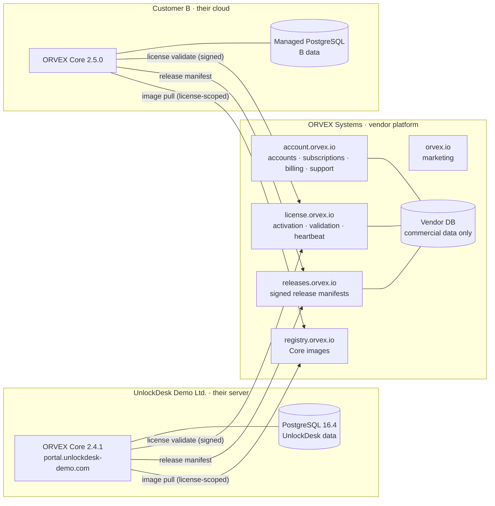
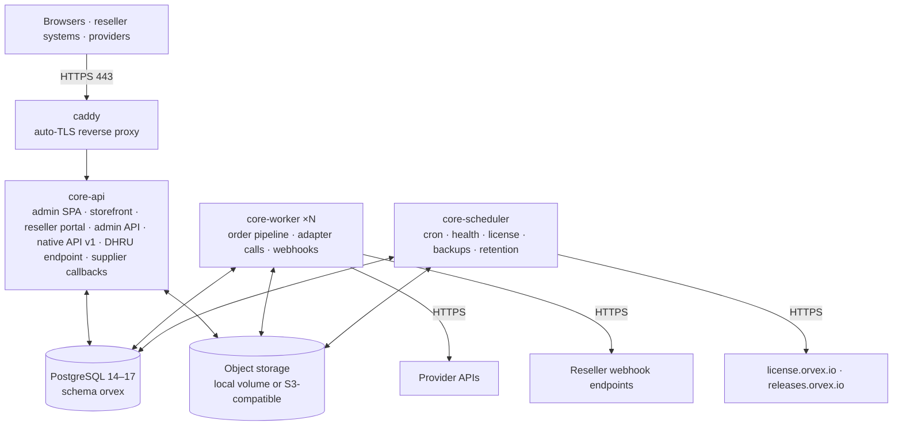
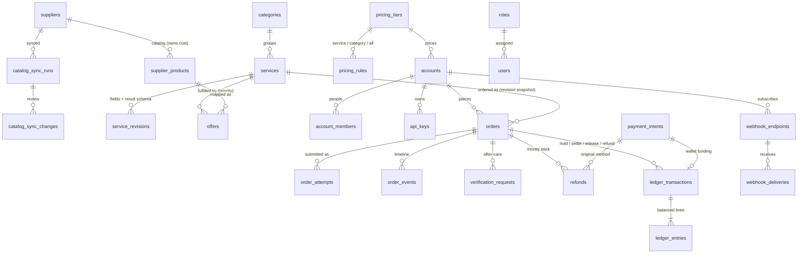
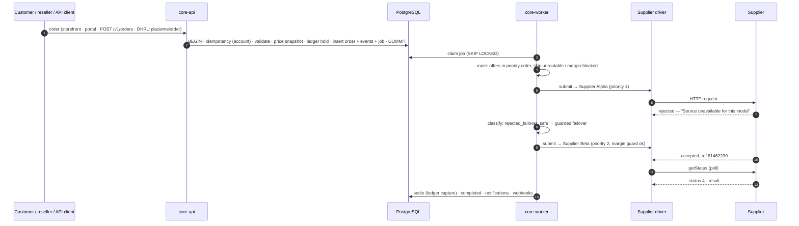
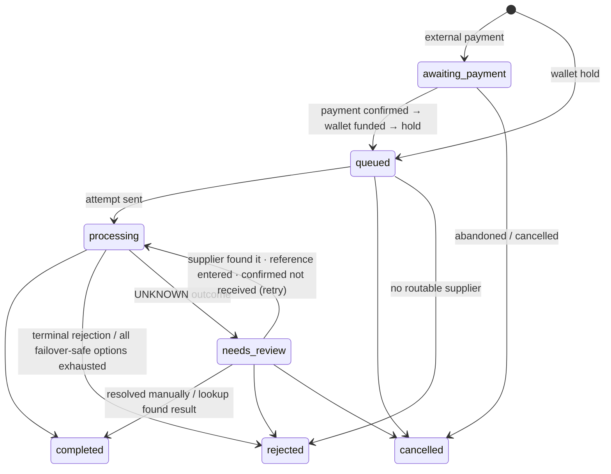
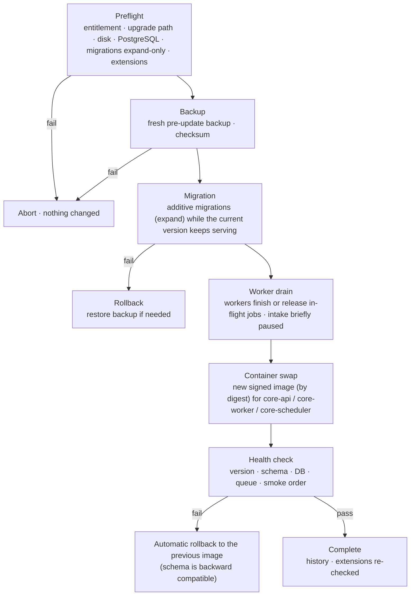
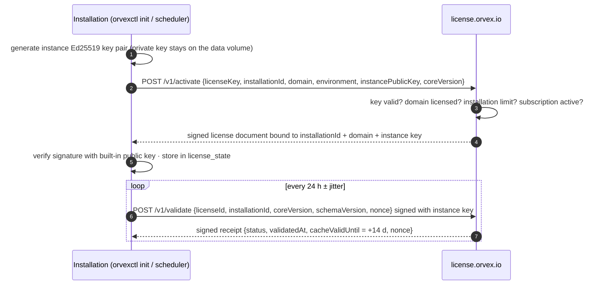

# ORVEX architecture

**ORVEX** (by ORVEX Systems) is a **licensed, self-hostable platform for running a digital-service
resale business**. A customer licenses **ORVEX Core** and runs an independent installation — on *their
own* server with *their own* PostgreSQL, or as a vendor-managed dedicated installation — with its own
suppliers, catalog, pricing, accounts (retail customers, resellers, businesses, API clients),
storefront, payments, native API, DHRU-compatible endpoint, ledger and logs. It is never a
multi-tenant SaaS: the vendor does not operate or hold the customer's operational data.

**Generic Core, GSM vertical pack.** Nothing in Core's engine, ledger or routing is specific to one
industry: a service is a versioned field schema fulfilled by prioritised supplier offers and priced by
tier rules. GSM concepts (IMEI with Luhn validation, serial, brand, model, carrier, result schemas)
live in the **GSM vertical pack**. The demo customer is **UnlockDesk Demo Ltd.** (`ORVEX-DEMO-001`)
selling legitimate GSM services — device and blacklist checks, carrier/SIM-lock status, warranty,
compatibility, serial checks and carrier-authorised unlock codes — through ten fictional suppliers
(DHRU Supplier Alpha, Beta Unlock Source, GammaCheck IMEI API, Delta GSM Server, Epsilon Code Factory,
Zeta Device Data, Eta Unlock Hub, Theta Carrier Desk, Iota Warranty Network, Kappa Manual Desk) to
retail customers, resellers (e.g. ABC GSM, MobileHub), businesses and API clients.

This document is the reference architecture for ORVEX Core V1 and the vendor platform around
it. It is consistent with the prototype's types (`src/types/*`), mock backends (`src/mock/*`), the
database schemas in `db/`, and the deployment package in `deploy/`.

| Related documents | |
|---|---|
| `docs/API_CONTRACT.md` | Admin API, Native API v1, DHRU-compatible endpoint, webhooks, vendor API, license-server protocol |
| `docs/ALIGNMENT_PLAN.md` | 2026-10 architecture alignment of the prototype (what changed and why) |
| `docs/ROADMAP.md` | Path from this prototype to production V1 |
| `db/README.md` | The two databases and the migration runner contract |
| `deploy/README.md` | Installing, configuring, backing up, updating and rolling back an installation |

## Contents

1. [Goals and principles](#1-goals-and-principles)
2. [Two planes: vendor platform and customer installations](#2-two-planes-vendor-platform-and-customer-installations)
3. [One Core, many installations](#3-one-core-many-installations)
4. [Installation runtime](#4-installation-runtime)
5. [Database and portability](#5-database-and-portability)
6. [Core + Configuration + Extensions](#6-core--configuration--extensions)
7. [Order orchestration](#7-order-orchestration)
8. [Native API v1 and DHRU compatibility](#8-native-api-v1-and-dhru-compatibility)
9. [Security](#9-security)
10. [Update architecture](#10-update-architecture)
11. [License architecture](#11-license-architecture)
12. [Operating hundreds of installations](#12-operating-hundreds-of-installations)
13. [From prototype to product](#13-from-prototype-to-product)
14. [Glossary](#14-glossary)

---

## 1. Goals and principles

**Goals**

* A customer can run a complete service platform (providers, catalog, routing, orders, resellers,
  pricing, API, webhooks, website) **on infrastructure they control**.
* ORVEX Systems can ship **one product** to hundreds of independent installations and keep them all
  updated safely and uniformly.
* Customers can be customised deeply **without forking Core**.

**Principles**

1. **Self-hosted from day one.** There is no hosted multi-tenant mode to retrofit. Every feature is
   designed to run inside one customer's environment.
2. **The database is the tenant boundary.** Each installation has its own PostgreSQL database. There
   is no `tenant_id` column anywhere in the installation schema; installation A's database cannot
   contain installation B's data because B's data never exists in A's environment.
3. **Customer data never leaves the customer's infrastructure.** Orders, inputs, results, resellers,
   provider credentials, API keys, logs and website content stay in the installation. Only explicit,
   minimal metadata crosses to the vendor (§2.3).
4. **Outbound-only vendor link; offline-tolerant.** Installations call the vendor (license,
   releases, optional heartbeat). The vendor never calls into an installation, and an installation
   keeps working for weeks without reaching the vendor.
5. **One Core, configured and extended, never forked.** Customer differences are configuration (in
   the customer's database) and extensions (signed packages). Core source is identical everywhere.
6. **Boring, portable technology.** Linux, Docker Compose, Node.js 22 LTS, PostgreSQL 14–17, Caddy
   or Nginx, environment-based configuration. PostgreSQL is the only stateful dependency: no Redis,
   no message broker, no PostgreSQL extensions.
7. **Standardised operations.** Every installation is installed, backed up, updated and rolled back
   the same way, by tooling, never by hand-editing a customer database.
8. **Secure by default.** Encrypted secrets at rest, hashed credentials, least privilege, signed
   releases, audited changes, sandboxed customer-authored code.
9. **Honest licensing.** Practical enforcement that never endangers customer data, with openly
   stated limits.

**Non-goals (V1):** hosting customer installations as multi-tenant SaaS; vendor remote control of
installations; active-active multi-region (the `multi_installation` HA module is on the roadmap).

---

## 2. Two planes: vendor platform and customer installations



### 2.1 Responsibilities

| Vendor platform (ORVEX Systems) | Customer installation (the customer) |
|---|---|
| Marketing site, plans, sign-up | Runs ORVEX Core on their server / cloud |
| Customer accounts and portal users | Installation-local admin users, roles, MFA |
| Subscriptions, invoices, payments | Providers and **encrypted** provider credentials |
| License issuance, activation, validation | Services, fields, mappings, routing rules |
| Release build, signing and distribution | Resellers, pricing groups, the balance ledger |
| Support tickets, professional services | Orders, attempts, results, webhooks, API keys |
| Fleet view: which version each installation runs | API logs, audit log, settings |
| | Public website (pages, sections, theme) |
| | Backups, updates (executed locally), monitoring |

### 2.2 Data ownership

| Data | Lives in | Visible to the vendor? |
|---|---|---|
| Account, team, subscription, invoices, payments | Vendor DB | Yes (vendor's own data) |
| License, licensed domains, modules | Vendor DB (+ signed copy cached in the installation) | Yes |
| Installation activation record (id, domain, environment, version, schema version, last heartbeat) | Vendor DB | Yes, metadata only |
| Providers, credentials, services, mappings, routing rules | Installation DB | **No** |
| Orders, inputs, results, events, ledger, resellers, pricing | Installation DB | **No** |
| API keys, webhooks, API/provider logs, audit log | Installation DB | **No** |
| Website content, theme, publications | Installation DB | **No** |
| Installation admin users | Installation DB | **No** (separate from vendor portal users) |

The vendor platform is architecturally incapable of becoming the customer's operational database:
its schema (`db/vendor/migrations`) has no table that could hold an order, a reseller or a
credential.

### 2.3 What crosses the boundary

Everything is initiated **outbound by the installation** over HTTPS; no inbound port is ever opened
for the vendor.

| Flow | When | Sent by the installation | Received | If the vendor is unreachable |
|---|---|---|---|---|
| License activation | Install, domain change | License key, installation id, domain, environment, instance public key, Core version | Signed license document | Installation cannot be activated (one-time) |
| License validation | Every 24 h ± jitter | License id, installation id, Core/schema version, nonce, signed with the instance key | Signed validation receipt (`cacheValidUntil`) | Keeps running on the cached signed license (§11) |
| Release check | Every 6 h | Channel, current version | Signed release manifests | Updates postponed; nothing else affected |
| Release download | On update | License-scoped registry token | Image (by digest), bundle | Update cannot start; current version keeps running |
| Heartbeat (optional) | Daily, `TELEMETRY_HEARTBEAT=minimal`, or `off` | Installation id, versions, health summary, update channel, license-relevant counters (e.g. admin users) | Acknowledgement, advisories | Nothing |
| Support | Customer-initiated | Ticket text; support bundle **only if the customer attaches it** | Replies | Nothing |

What **never** crosses: orders, order inputs or results, end-customer data, reseller data, provider
credentials, API keys, webhook payloads, logs, website content, admin users.

---

## 3. One Core, many installations

```
                        ORVEX Systems release pipeline
     source ──► build ──► test ──► sign (Ed25519, HSM) ──► publish
                                                              │
                         releases.orvex.io (manifests) ◄──────┤
                         registry.orvex.io (images)    ◄──────┘
                                   │  outbound pulls only
        ┌──────────────────────────┼──────────────────────────┐
        ▼                          ▼                          ▼
 ┌────────────────────┐    ┌────────────────────┐    ┌────────────────────┐
 │ UnlockDesk Prod    │    │ UnlockDesk Staging │    │ Customer B         │   … hundreds
 │ core 2.4.1         │    │ core 2.5.0         │    │ core 2.5.0         │
 │ ext: dsn-adapter   │    │ ext: dsn-adapter   │    │ ext: —             │
 │ ┌────────────────┐ │    │ ┌────────────────┐ │    │ ┌────────────────┐ │
 │ │ PG 16.4        │ │    │ │ Neon PG 16     │ │    │ │ RDS PG 15      │ │
 │ │ schema 017     │ │    │ │ schema 018     │ │    │ │ schema 018     │ │
 │ └────────────────┘ │    │ └────────────────┘ │    │ └────────────────┘ │
 └────────────────────┘    └────────────────────┘    └────────────────────┘
   own server,               own server,               own cloud,
   own secrets               own secrets               own secrets
```

Every installation runs the **same signed image** (`registry.orvex.io/core:<version>`), with its
own `.env`, database, storage, configuration and extensions.

**Isolation properties**

* No shared runtime, database, queue, cache, storage bucket or secret between installations.
* A crash, misconfiguration, bad extension, data corruption or restore in installation A has no
  path to affect installation B.
* Installations can run different versions (UnlockDesk Production on 2.4.1 while UnlockDesk Staging tests 2.5.0)
  and update on their own schedule.
* A vendor-platform outage does not stop any installation (§11.4).

**Failure scenarios**

| Scenario | Blast radius | Recovery |
|---|---|---|
| Installation A's database corrupted | A only | Restore A's backup in A's environment |
| A's admin installs a broken custom extension | A only | Disable the extension; Core is untouched |
| A supplier times out (e.g. DHRU Supplier Alpha) | Each installation connected to it, independently | Affected orders go to Needs Review (no blind failover); new orders keep routing; the circuit breaker pauses a failing supplier |
| Vendor platform down | None operationally | Installations continue on cached licenses; updates wait |
| Defective release published | Installations that updated | Staged rollout limits exposure; release withdrawn; automatic rollback on failed health check |

**This is not multi-tenant SaaS**

| | Multi-tenant SaaS | ORVEX |
|---|---|---|
| Customer data | Shared database, `tenant_id` filters | Separate database per installation |
| Who operates it | Vendor | Customer (optionally vendor-assisted) |
| Failure isolation | Logical | Physical |
| Customisation | Feature flags | Configuration + extensions |
| Vendor access to data | Always | Never (only consented support sessions) |

---

## 4. Installation runtime



### 4.1 Containers

All Core containers run the **same image** with a different role, so there is exactly one artifact
to build, sign, verify and roll back.

| Container | Command | Responsibility | Scaling |
|---|---|---|---|
| `core-api` | `orvex serve api` | Serves the admin SPA (`/admin`), the storefront (`/`), the reseller portal (`/portal`), the admin API (`/api/admin`), the native API (`/v1`), the DHRU-compatible endpoint (`/api/dhru`), supplier callbacks (`/hooks/suppliers/:id`), `/healthz`, `/readyz` | 1 in V1; more behind Caddy with the HA module |
| `core-worker` | `orvex serve worker` | Consumes jobs: order processing, provider submissions and polling, webhook deliveries, catalog sync | Horizontal (`docker compose up --scale core-worker=3`); `QUEUE_WORKERS` concurrency each |
| `core-scheduler` | `orvex serve scheduler` | Claims due `scheduled_tasks`, enqueues jobs; health checks, license validation, update checks, backups, partition maintenance, retention, ledger reconciliation | 1 (safe with more: claims use `SKIP LOCKED`) |
| `caddy` | `caddy:2.8-alpine` | TLS (ACME), HTTP/2 and HTTP/3, compression, header hardening, proxy | 1 |
| `postgres` (optional) | `postgres:16-alpine` | Bundled database (`bundled-db` profile) for customers without managed PostgreSQL | n/a |

Containers run read-only, as non-root, with all capabilities dropped and `no-new-privileges`; the only
writable volume is `core-data` (`/var/lib/orvex`: instance key, local storage, update journal).

### 4.2 Queue on PostgreSQL

Background work goes through the `jobs` table (`db/installation/migrations/012_job_queue.sql`). Workers
claim jobs with `FOR UPDATE SKIP LOCKED`, so concurrent workers never block each other or receive the
same job:

```sql
WITH next AS (
  SELECT id FROM jobs
  WHERE status = 'queued' AND queue = $1 AND run_at <= now()
  ORDER BY priority DESC, run_at
  FOR UPDATE SKIP LOCKED
  LIMIT $2
)
UPDATE jobs j
   SET status = 'running', attempts = j.attempts + 1, locked_by = $3,
       locked_at = now(), lease_expires_at = now() + interval '5 minutes'
  FROM next WHERE j.id = next.id
RETURNING j.*;
```

* **Transactional enqueue.** An order, its ledger charge and its `order.process` job are written in
  one transaction: there is no window where an order exists without its work (or vice versa), which
  an external broker cannot guarantee.
* **Leases.** A worker that dies leaves a `running` job whose lease expires; the scheduler re-queues
  it. Handlers are idempotent (§7.5).
* **Retries** move `run_at` with exponential backoff; exhausted jobs become `dead` and surface on the
  Health page.
* **Wake-up.** An insert trigger issues `NOTIFY orvex_jobs`. Behind transaction-mode poolers
  (Supabase/Neon pooled endpoints, PgBouncer) `LISTEN` is unavailable, so workers also poll every
  `QUEUE_POLL_INTERVAL_MS`; `LISTEN` uses `DATABASE_DIRECT_URL` when provided.
* **Why not Redis?** One stateful dependency to install, back up, secure and upgrade instead of two.
  At the volumes of a single installation (thousands of orders per day; the demo processes ~190/day)
  PostgreSQL queues have ample headroom.

### 4.3 Scheduler

`scheduled_tasks` holds cron schedules (UTC). Each tick the scheduler claims due rows with
`FOR UPDATE SKIP LOCKED`, enqueues the job and computes `next_run_at`, all in one transaction. No
advisory locks, no leader election, and it works through poolers.

| Task | Default schedule | Job |
|---|---|---|
| `provider.health_check` | every minute | ping adapters, update provider status, open/close incidents |
| `stats.rollup` | every 5 min | provider daily stats, routing-rule hits, webhook stats |
| `license.validate` | every 15 min (contacts the server only when `next_validation_at` is due) | §11 |
| `updates.check` | every 6 h | fetch signed manifests for the channel |
| `backup.nightly` | 03:00 UTC | `pg_dump` → storage, checksum, manifest |
| `maintenance.partitions` | 00:10 UTC | create next months' `api_request_logs` partitions |
| `maintenance.retention` | 02:30 UTC | drop expired log partitions, prune logs, purge expired sensitive inputs |
| `ledger.reconcile` | 03:45 UTC | verify every reseller balance equals the sum of its ledger entries |

### 4.4 Storage

`STORAGE_DRIVER=local` (the `core-data` volume) or `s3` (AWS S3, MinIO, Hetzner Object Storage,
Cloudflare R2…). Holds files referenced by orders (`file_7h2k9d0q1m3x`, short-lived and virus-scanned
on upload, e.g. a bulk IMEI list or an MDM release letter), exports, website assets and backups.
Object keys never contain personal data.

### 4.5 Configuration

| Layer | Where | Examples | Changed by |
|---|---|---|---|
| Infrastructure & secrets | Environment (`.env`) | `DATABASE_URL`, `ENCRYPTION_KEY`, `LICENSE_KEY`, `STORAGE_*`, `SMTP_URL` | Operator, restart |
| Business configuration | Installation database | Services, routing, pricing, settings sections, website | Admins in the UI, live |
| Customisation | Extensions | Adapters, themes, business rules | Admins (signed packages) |

### 4.6 Observability

* Structured JSON logs to stdout with `request_id` correlation across API logs, order events,
  provider logs and webhook deliveries. Secrets and sensitive fields are redacted at the logger.
* `/healthz` (liveness: process, version, schema version), `/readyz` (readiness: database, pending
  migrations, storage, license state). Caddy blocks `/readyz` and `/metrics` from outside.
* Prometheus metrics on an internal port (`/metrics`), optional OpenTelemetry export.
* The Health page reads `system_health_checks` and `incidents` (the prototype's `HealthSnapshot`).

---

## 5. Database and portability

### 5.1 Configuration-driven connectivity

The database is selected **only** by environment variables; there is no provider-specific code.

| Variable | Meaning |
|---|---|
| `DATABASE_URL` | Connection string (may point at a pooler) |
| `DATABASE_DIRECT_URL` | Optional direct connection for migrations, advisory locks and `LISTEN` |
| `DATABASE_SCHEMA` | Schema for all Core objects (default `orvex`) |
| `DATABASE_POOL_MAX` | Pool size per process |
| `DATABASE_SSL_MODE` | `disable` / `require` / `verify-full` (matches `InstallationInfo.database.sslMode`) |
| `DATABASE_SSL_CA_FILE` | CA bundle for `verify-full` |

Works with self-hosted PostgreSQL, Supabase, Neon, AWS RDS/Aurora PostgreSQL, Hetzner, or any
service offering genuine PostgreSQL 14–17 semantics. Example URLs and provider notes:
`deploy/README.md § 4`. In the demo, UnlockDesk Production runs on self-hosted PostgreSQL 16.4 on a Hetzner
dedicated server while UnlockDesk Staging runs on Neon, using the same image.

### 5.2 Portability rules (enforced in code review)

1. **No extensions.** Only built-ins (`gen_random_uuid()`, `sha256()`, PL/pgSQL, declarative
   partitioning, `SKIP LOCKED`).
2. **No superuser.** The Core role owns its schema and nothing else.
3. **Own schema.** Everything lives in `orvex` (configurable), never `public`; on Supabase this
   keeps tables out of the auto-generated REST API.
4. **Pooler-safe.** No session state on pooled connections; prepared statements are disabled when a
   transaction pooler is detected; `LISTEN` and the migration lock use the direct URL; the scheduler
   uses row claims rather than advisory locks.
5. **Portable backups.** `pg_dump --format=custom` of the schema restores into any supported provider;
   moving providers is backup → restore → change `DATABASE_URL`.

Not supported in V1: wire-compatible databases with different semantics (e.g. CockroachDB), MySQL
(1.x installations on MySQL were migrated by the 2.0 importer).

### 5.3 Data model

The prototype's domain types (`src/core/domain/*`) are the reference for the production schema
(`db/installation/migrations`, with `019_core_v2.sql` describing the aligned model). Core relationships:



Conventions: `uuid` keys, `bigint` identities for append-heavy tables, `timestamptz`, **money as
`bigint` micro-units** (1 USD = 1 000 000 — never floating point), `jsonb` documents, `CHECK`
constraints for every enum (values identical to the TypeScript unions), append-only triggers on
`audit_logs`, `order_events`, `ledger_transactions` and `ledger_entries`.

### 5.4 Data retention

| Data | Default retention | Mechanism |
|---|---|---|
| `api_request_logs` | 90 days | Drop whole monthly partitions |
| `provider_logs`, `system_health_checks` | 30 days | Batched deletes |
| `audit_logs` | `settings.security.auditRetentionDays` (365) | Explicit purge with `orvex.retention_purge` |
| Sensitive order inputs (`orders.input_sensitive_*`) | 90 days after completion (configurable) | Set to NULL, `sensitive_purged_at` recorded; masked `input` remains |
| Orders, ledger | Indefinite (customer's business records) | Customer policy |
| Backups | `BACKUP_RETENTION_DAYS` (14) | Expired in storage |

---

## 6. Core + Configuration + Extensions

> **CORE + CONFIGURATION + EXTENSIONS = CUSTOMER INSTALLATION**

| Layer | What | Who changes it | Survives a Core update? |
|---|---|---|---|
| **Core** | The signed image: engine, admin, APIs, built-in adapters | ORVEX Systems, by release | Replaced as a whole |
| **Configuration** | Rows in the customer's database: providers, services, mappings, routing rules, pricing, settings, website content | Customer admins | Yes, migrated forward |
| **Extensions** | Signed packages: adapters, service types, themes, website components, business rules, modules | Customer, ORVEX (official), ORVEX professional services or the customer's developers (custom) | Yes, checked against `coreRange` |

Customer-specific behaviour **never** requires modifying Core. Example from the demo: Device Services
Network's batch IMEI API (50 IMEIs per HMAC-signed request, results by callback) needed a custom
adapter; it was delivered as extension `ext.unlockdesk.dsn-adapter` 1.0.3 (ticket TCK-1988, including
a Luhn pre-check so one bad IMEI does not reject a whole batch), installed alongside Core, and Core
updates do not touch it.

### 6.1 Extension kinds (`ExtensionKind`)

| Kind | Extends | Demo example |
|---|---|---|
| `supplier-driver` | How Core talks to a supplier API (implements `SupplierDriver`) | `driver.dhru-fusion`, `driver.orvex-rest`, `driver.manual` (core) |
| `vertical-pack` | Field types, categories, result schemas for an industry | `pack.gsm` — IMEI (15 digits + Luhn), serial, brand, model, carrier |
| `payment-gateway` | A payment method feeding the ledger | `gateway.demo-card`, `gateway.demo-paypal` (simulated) |
| `service-type` | Additional field types and validation | — |
| `theme` | Storefront theme and tokens | `theme.storefront` |
| `website-component` | Additional typed storefront blocks | — |
| `business-rule` | Hooks into pricing or order validation (never into money movement) | — |
| `module` | Larger optional features with their own screens | `module.statements`, `ext.unlockdesk.erp-sync` (custom) |

### 6.2 Manifest and package

The manifest is the `ExtensionManifest` type (`src/types/extensions.ts`):

```json
{
  "id": "ext.unlockdesk.erp-sync",
  "name": "UnlockDesk ERP Export",
  "kind": "module",
  "version": "0.9.2",
  "coreRange": "~2.4.0",
  "author": "UnlockDesk Demo Ltd. (custom)",
  "source": "custom",
  "description": "Nightly export of ledger transactions to UnlockDesk's accounting system. Built by ORVEX professional services.",
  "permissions": ["network:outbound", "secrets:read", "queue:write"]
}
```

A package (`.orx`, a signed tarball) contains `manifest.json`, the compiled entry module
(`dist/index.mjs`), an optional `config.schema.json` (rendered as a settings form; secret fields go
into the encrypted bundle), optional `migrations/` for the extension's **own schema**
(`ext_unlockdesk_dsn_adapter`, tracked in `schema_migrations` with `component = <extension id>`), and
`SIGNATURE` (Ed25519 over the SHA-256 of every file).

### 6.3 Compatibility

`coreRange` is a semver range checked **at install, at boot, and in update pre-flight**. An
extension that does not satisfy the target version does not block an update: it is disabled during
the update (`status = incompatible`) and the pre-flight shows a warning, as in the demo:

> *VIP Reseller Routing (~2.4.0) is not declared compatible with 2.5. It will be disabled during
> update.*

The fix is a new extension version (TCK-2033: professional services prepared 1.0.0 targeting
`^2.5.0`), never a Core patch. Core keeps the extension API stable within a major version; breaking
changes to extension APIs are announced one minor ahead and listed in the release manifest
(`extensionApi`).

### 6.4 Permissions (capabilities)

Requested in the manifest, reviewed and granted by an admin at install, enforced by the SDK object
handed to the extension (an extension has no raw database handle):

| Permission | Grants |
|---|---|
| `network:outbound` | HTTPS through Core's HTTP client; adapters only to their provider's base URL |
| `secrets:read` | Decrypted credentials of the provider connection it serves |
| `queue:write` | Enqueue jobs in its own job kinds |
| `storage:write` | Write objects under its own storage prefix |
| `catalog:read` | Read services and public prices |
| `routing:extend` | Register a routing hook that can reorder/exclude providers |
| `transactions:read` | Read the ledger |
| `email:send` | Send email through the installation's SMTP |

### 6.5 Signing and trust

* Every non-core package must be signed. ORVEX's extension keys are compiled into Core; customers
  can add their own developer keys (`extension_trusted_keys`) for in-house extensions.
* Unsigned or tampered packages are refused; the package SHA-256 and signature are stored with the
  installed extension.
* Isolation (V1): each extension runs in its own worker thread with only its capability-scoped SDK.
  This limits accidents and blast radius but is not a hard security sandbox against malicious code
  (in-process JavaScript cannot be fully sandboxed); trust therefore rests on signing plus
  permission review. A process-level sandbox is on the roadmap.

### 6.6 The supplier driver contract

Core never talks to a supplier directly. Every supplier is bound to a driver (`suppliers.driver`), and
drivers implement `SupplierDriver` (`src/core/ports.ts`):

| Operation | Used by | Notes |
|---|---|---|
| `testConnection()` | *Suppliers → Test connection*, health checks | Steps: TLS, authenticate, API version, account info |
| `getBalance()` | Scheduler (every few minutes) and on demand | Feeds the supplier-reported balance used by reconciliation |
| `syncCatalog()` | *Sync catalog* | Remote products are diffed into reviewable changes (new / price / removed / fields / warnings) |
| `submit()` | Worker, per attempt | Returns accepted / rejected / rate-limited / insufficient funds / auth failed / connection refused / timeout / bad response — classified by Core |
| `getStatus()` | Polling for async results, review lookups, verification rechecks | Lookup by supplier reference or by the ORVEX order reference sent as `REFERENCE` |
| `parseCallback()` | `POST /hooks/suppliers/:id` | Signature verified first when the supplier signs callbacks |
| `normalizeResult()` | Result mapping into the service's result schema | |
| `cancel()` | Optional | DHRU Fusion v6.1 has no cancel action for IMEI orders |

The **DHRU Fusion driver** speaks the DHRU-compatible HTTP API: form-POST to `/api/index.php` with
`username`, `apiaccesskey`, `action` (`accountinfo`, `imeiservicelist`, `placeimeiorder`,
`getimeiorder`), `requestformat=JSON` and an XML `parameters` envelope; responses are JSON
`{"SUCCESS":[…]}` / `{"ERROR":[…]}` with numeric statuses 0 / 1 / 3 / 4. It is **not SOAP/WSDL**, and
DHRU statuses are translated at the driver edge — Core never stores them. Credentials are decrypted in
memory for the call only and never logged.

## 7. Order orchestration

### 7.1 One command for every channel

Storefront checkout, reseller portal (single and bulk), native API v1, the DHRU-compatible endpoint
and admin-created orders all call the same commands (`src/core/commands`):

| Command | Does |
|---|---|
| `PlaceOrder` | idempotency (account-scoped) → validate input against the service revision → price (PricingEngine, snapshotted) → availability → limits → hold funds (or create a payment intent) → queue |
| `SettleOrder` | result received → capture: DR Customer Held / DR Cost of Sales / CR Revenue / CR Supplier Prepaid → notify |
| `RejectOrder` | definitive failure → release hold → notify |
| `CancelOrder` | before any supplier has the order → release hold / void payment |
| `RefundOrder` | captured money back to wallet or original method — capped, audited, idempotent; the order stays `completed` |
| `ResolveReview` | lookup supplier · confirm not received · enter supplier reference · resolve manually (reason + audit) |
| `VerifyOrder` | after-care: open, recheck supplier, request supplier verification, approve refund, reject |



### 7.2 Order states

Fulfilment and money are separate dimensions.



Financial status: `none → held → captured → partially_refunded → refunded`, or `held → released`.
`refunded` is never a fulfilment status. Customers see `needs_review` as `processing` with
`status_detail: under_review`.

### 7.3 Routing (V1)

* **Priority routing.** Offers are tried in `priority` order. No weighted, round-robin, cost or
  latency strategies in V1 — they need measured data first and make outcomes harder to explain.
* An offer is **skipped** when it is disabled, its supplier product was removed upstream, its supplier
  is not routable (disabled, maintenance, authentication failing, circuit open) or the **margin guard**
  blocks it (supplier cost above the order's snapshotted price, or above the offer's max cost).
* **Circuit breaker** per supplier: 5 consecutive failures open the circuit; after the cooldown the
  circuit is half-open and the next order is a probe.

### 7.4 Outcome classification and guarded failover

| Supplier response | Class | Next step |
|---|---|---|
| Accepted (result now or later) | `success` | settle (instant) or poll |
| Definitive rejection, input/eligibility (IMEI not found, not eligible) | `rejected_terminal` | reject — another supplier would give the same answer |
| Definitive rejection mapped as safe (source unavailable, out of stock, service disabled) | `rejected_failover_safe` | **guarded failover** to the next eligible offer |
| Rate limited, insufficient supplier funds, authentication failed, connection refused (request provably not processed) | `not_accepted` | **guarded failover** |
| Timeout, or an unusable response after the request was sent | `unknown` | **needs_review** — automatic failover is **blocked** to prevent duplicate supplier orders; funds stay held |

Error mappings per supplier decide which rejection messages are failover-safe. An unknown outcome is
resolved by an operator: *Lookup supplier* (the driver asks the supplier for the ORVEX reference),
*Confirm supplier did not receive* (then failover is allowed), *Enter supplier reference*, or *Resolve
manually* — each requires a reason and writes an audit event.

### 7.5 Idempotency at every layer

| Layer | Mechanism |
|---|---|
| API / channels | `Idempotency-Key` scoped to the **account** (not the key or channel) for 24 h: same body replays the original order (`Idempotent-Replayed: true`), a different body → `409 idempotency_conflict`. DHRU clients' `REFERENCE` is used as the key when present |
| Jobs | Leases + idempotent handlers: every handler re-reads order/attempt state before acting |
| Suppliers | The ORVEX order reference is sent with each attempt (`REFERENCE`), enabling lookups after a timeout |
| Ledger | Every transaction carries a unique idempotency key (`order:<id>:hold`, `order:<id>:settle`, `payment:<id>:capture`, …) |
| Payment webhooks | Gateway event ids are de-duplicated; a duplicated `payment.succeeded` is recorded and ignored |
| Outbound webhooks | Stable `webhook-id` across retries; receivers de-duplicate |

### 7.6 Ledger and balances

* Double-entry: every `ledger_transaction` has balanced `ledger_entries` (Σ debits = Σ credits);
  balances are projections — there is no mutable balance column.
* Posting rules: top-up DR Gateway Clearing / CR Customer Available · hold DR Customer Available /
  CR Customer Held · settlement DR Customer Held (price) + DR Cost of Sales (cost) / CR Revenue (price)
  + CR Supplier Prepaid (cost) · release DR Customer Held / CR Customer Available · refund DR Refunds /
  CR Customer Available (or Gateway Clearing for the original method) · chargeback · goodwill ·
  supplier top-up DR Supplier Prepaid / CR Bank.
* Every payment funds a wallet first; the order engine only ever deals with wallet holds.
* Integrity checks run continuously: balanced transactions, trial balance, projections vs
  recomputation, holds match open orders, captured orders settled exactly once, payments funded once,
  wallets within credit limits, supplier balances reconcile.
* **Supplier reconciliation** compares the supplier-reported balance with the ledger
  (`expected = Supplier Prepaid − in-flight accepted costs`); drift usually equals the cost of an
  unknown-outcome order the supplier did process.

---

## 8. Native API v1 and DHRU compatibility

Base URL `https://<installation domain>/v1` (UnlockDesk: `https://portal.unlockdesk-demo.com/v1`).
Full contract: `docs/API_CONTRACT.md § 3`.

| Endpoint | Scope |
|---|---|
| `GET /v1/services`, `GET /v1/services/:id` | `services:read` |
| `POST /v1/orders`, `POST /v1/orders/batch` | `orders:write` |
| `GET /v1/orders`, `GET /v1/orders/:id` | `orders:read` |
| `POST /v1/orders/:id/cancel`, `POST /v1/orders/:id/verify` | `orders:write` |
| `GET /v1/account`, `GET /v1/account/transactions` | `account:read` |

**Authentication.** `Authorization: Bearer orx_live_…`. Keys belong to **accounts** (any tier with API
access), carry scopes, a rate limit, an optional IP allow-list and an optional expiry. Only the prefix
and a hash are stored; the secret is shown once.

**Representation.** Money is a decimal string (`{"amount": "0.94", "currency": "USD"}`). Orders expose
`status`, `status_detail` and a separate `financial_status`.

**Webhooks (Standard Webhooks).**

```
webhook-id: msg_2Lk9…            (stable across retries — de-duplicate on it)
webhook-timestamp: 1759312800
webhook-signature: v1,K5oZfzN95Z9UVu1EsfQmfVNQhnkZ2pj9o9NDN/H/pI4=
```

Signature = base64(HMAC-SHA256(secret, `${id}.${timestamp}.${body}`)). Retries: immediately, 5 s,
5 min, 30 min, 2 h, 5 h, 10 h, 10 h (8 attempts); then the delivery is failed, the endpoint marked
`failing` and the operator notified. Any delivery can be replayed with the same `webhook-id`.

**DHRU-compatible endpoint.** `POST https://<domain>/api/dhru` accepts DHRU Fusion reseller clients
unchanged (`username` = account email, `apiaccesskey` = an ORVEX key with DHRU compatibility,
actions `accountinfo`, `imeiservicelist`, `placeimeiorder`, `getimeiorder`). The edge translates to
`PlaceOrder` (channel `dhru`) and maps statuses back: queued/awaiting payment → 0, processing/needs
review → 1, rejected/cancelled → 3, completed → 4. The **DHRU migration importer** (scan → dry run →
diff → review → import → validate) moves services, clients, supplier connections, price groups and
opening balances from a DHRU panel.

---

## 9. Security

### 9.1 Threat model (summary)

| Asset | Threat | Controls |
|---|---|---|
| Provider credentials | DB dump, backup leak, insider read | AES-256-GCM at rest, key outside the DB, write-only API, masked hints |
| Native API & DHRU endpoint | Key theft, brute force, abuse, duplicate submissions | Hashed keys, prefixes, scopes, IP allow-lists, rate limits, revocation, account-scoped idempotency, audit |
| Admin | Credential stuffing, session theft, CSRF | Argon2id, MFA (enforceable), httpOnly/Secure/SameSite cookies, idle + absolute timeouts, lockout, CSRF tokens, admin IP allow-list |
| Money | Double charge, overdraft, tampering | DB-enforced ledger invariants, append-only entries, reconciliation |
| Public website | XSS via customer-authored sections | Sanitised HTML, scoped CSS, JS only in sandboxed iframes, CSP |
| Platform integrity | Malicious/tampered update or extension | Signed releases and packages, digest pinning, verification by already-installed code |
| Personal data | Over-collection, leakage in logs | Sensitive-field encryption and purge, masking in logs and webhooks, retention |
| Outbound calls | SSRF via webhook/provider URLs | HTTPS-only webhooks, private-range blocking unless explicitly allowed |

### 9.2 Secrets, encryption and hashing

* **Key ring.** `ENCRYPTION_KEY` (32 bytes, from the environment, never in the database) is the root;
  per-purpose data keys are derived with HKDF-SHA256 (`orvex/provider-credentials/v1`,
  `orvex/webhook-secrets/v1`, `orvex/mfa/v1`, `orvex/order-inputs/v1`).
* **Encryption at rest**: AES-256-GCM, random 96-bit nonce per encryption, auth tag appended,
  associated data binding the ciphertext to its row (e.g. `provider_connections:<id>`), and a
  `key_id` column for rotation. Encrypted: provider credential bundles, webhook signing secrets, MFA
  secrets, sensitive order inputs, extension secrets.
* **Hashing** (never reversible): admin passwords and API keys with Argon2id (m = 19 MiB, t = 2,
  p = 1); session and one-time tokens with SHA-256 (high-entropy random values).
* **Write-only secrets.** The API never returns a stored secret; the UI shows masked hints
  (`gu_••••••••••••••••7f2c`) and supports rotation.
* **Rotation.** New `ENCRYPTION_KEY`/`ENCRYPTION_KEY_ID`, previous key in `ENCRYPTION_KEYS_PREVIOUS`;
  a background job re-encrypts rows; then the old key is removed.

### 9.3 Admin access control

* RBAC with `resource:action` permissions and wildcards (`*`, `orders:*`); system roles *Owner* and
  *Administrator*; customer-defined roles (demo: Operations, Developer, Finance, Support). Every
  permission is checked server-side; hiding UI is cosmetic only.
* MFA (TOTP) enforceable for all admins (`settings.security.enforceMfa`), sessions bound to
  `sessionTimeoutMin`, admin IP allow-list (`ipAllowlistAdmin`), password minimum length.
* **Audit log** (`audit_logs`): every configuration change, credential rotation, key creation or
  revocation, refund, role change, publish, update and license event, with actor, IP, request id
  and field-level changes (secrets redacted). Append-only, retained `auditRetentionDays`, exportable to
  a SIEM.

### 9.4 Storefront content safety

The storefront is built from **typed blocks** (hero, rich text, image, FAQ, testimonials, CTA,
catalog grid, service spotlight, category tiles, trust bar, steps, quick check). Catalog blocks hold
service ids or queries only — prices, fields and availability are resolved live, so content can never
show a stale price. The only free-form block (`custom_embed`) is sanitised on save and on render (no
scripts, no event handlers, no `javascript:` URLs), and the storefront ships a strict CSP. Guest order
tracking uses a 32-character random token; an order reference alone never reveals a result.

### 9.5 Transport, supply chain and data protection

* TLS everywhere: Caddy (auto-TLS, HSTS) at the edge; `verify-full` to managed databases where
  available; certificate verification for all provider and webhook calls.
* Releases and extensions are signed (Ed25519, keys in an HSM); images pinned by digest; SBOM per
  release; dependency and container scanning in CI.
* Sensitive service fields (`service_fields.sensitive`) are encrypted on the order, masked everywhere
  else (UI, logs, webhooks) and purged after the retention window.
* The customer is the controller of all installation data. ORVEX Systems has no access to it and is
  therefore not its processor; consented support sessions are the documented exception (§12.3).

---

## 10. Update architecture

### 10.1 What a release is

Every release is one immutable, signed unit with: version (semver), channel (`stable`/`beta`), release
notes, database migration range (`017 → 018`), minimum upgrade-from version, compatibility (Node,
PostgreSQL, Docker), artifacts with sizes, SHA-256 and signatures, a backup requirement, and the
health-check expectation. This is the prototype's `Release` type, served by `releases.orvex.io` as a
signed manifest:

```json
{
  "format": "orvex-release/v1",
  "product": "orvex-core",
  "version": "2.5.0",
  "channel": "stable",
  "releasedAt": "2026-09-29T09:00:00Z",
  "title": "Routing engine v3 & webhook monitoring",
  "minUpgradeFrom": "2.3.0",
  "breaking": false,
  "requiresBackup": true,
  "compatibility": { "node": ">= 22.11 LTS", "postgres": "14 – 17", "docker": ">= 24" },
  "database": {
    "from": "017",
    "to": "018",
    "backwardCompatibleWith": "2.4",
    "migrations": [
      { "version": "018", "name": "webhook_delivery_attempts", "sha256": "4be1…09ac", "transactional": true }
    ],
    "steps": [
      "Create table webhook_delivery_attempts",
      "Add column routing_rules.weight",
      "Backfill webhook delivery statistics",
      "Create index orders (created_at DESC, status)"
    ]
  },
  "artifacts": [
    {
      "kind": "container_image",
      "ref": "registry.orvex.io/core:2.5.0",
      "digest": "sha256:7d1e…c4f2",
      "platforms": ["linux/amd64", "linux/arm64"]
    },
    {
      "kind": "update_bundle",
      "uri": "https://releases.orvex.io/core/2.5.0/orvex-core-2.5.0.tar.zst",
      "sizeBytes": 91844608,
      "sha256": "3f9b…a71e"
    }
  ],
  "extensionApi": "2.5",
  "healthCheck": { "path": "/healthz", "timeoutSec": 120, "expect": { "version": "2.5.0", "schemaVersion": "018" } },
  "notes": [
    { "type": "feature", "text": "Routing engine v3 — health-weighted strategy across suppliers and sub-millisecond rule evaluation" },
    { "type": "feature", "text": "Supplier balance alerts — email and balance.low webhook when a provider balance crosses its low-balance threshold" },
    { "type": "security", "text": "Hashed API keys and a strict CSP for the storefront" }
  ],
  "signature": {
    "algorithm": "Ed25519",
    "keyId": "orvex-release-2026",
    "signedBy": "ORVEX Release Key 2026",
    "value": "ed25519:Mz2k…9QwP"
  }
}
```

The signature covers the canonical JSON (RFC 8785) of the manifest without the `signature` member.
Core embeds the public keys of the current **and next** release key, so keys rotate without a gap.

### 10.2 Flow

The flow is identical for every installation and for self-managed and vendor-managed updates:
**Preflight → Backup → Migration (expand-only) → Worker drain → Container swap → Health check →
Complete**.



Because migrations only *add* schema (expand/contract), the old version keeps working on the new
schema; removal of old columns happens in a later release. This is what keeps the maintenance window
to the worker drain + container swap and makes app-only rollback safe. The prototype's Update Center
animates exactly these steps (`UpdateStepId`).

### 10.3 Details

* **Who executes it.** The host-side updater (`orvexctl`, also running as `orvexctl agent` for
  updates requested from the admin UI). Long-running containers never get the Docker socket. Updates
  never require inbound vendor access, and the vendor never edits a customer database.
* **Trust anchor.** Verification uses the keys in the **currently installed** Core before any code
  from the new release runs.
* **Preflight checks** (ids as in the prototype): `entitlement` (update entitlement until
  `updatesUntil`), `version` (upgrade path ≥ `minUpgradeFrom`), `disk`, `postgres`, `migrations`
  (expand-only), `extensions` (`coreRange` vs target), `backup` (recent backup present; a fresh one is always taken).
* **Worker drain** happens after the expand migrations: workers finish or release in-flight jobs,
  intake pauses for the seconds the container swap takes (`503` + `Retry-After` on the APIs). Typical
  window: under a minute.
* **Migrations** follow the runner contract (`db/README.md`): forward-only, checksum-verified,
  one transaction per file, recorded in `schema_migrations`, refused without a verified pre-update
  backup.
* **Expand/contract discipline.** A release may only *add* schema (tables, nullable or defaulted
  columns, indexes). Removing or renaming happens in a later release once no supported version uses the
  old shape. This is what makes `backwardCompatibleWith` and app-only rollback possible; 018 is purely
  additive.
* **Health check.** `/healthz` must report the expected version and schema, `/readyz` must pass, and a
  smoke order runs through the sandbox adapter within `timeoutSec`.
* **Rollback.** App-only when the schema change is declared backward compatible, otherwise restore of
  the pre-update backup (§10.2). The demo history shows exactly this: 2.3.0 rolled back on 14 June,
  succeeded on 15 June.
* **Journal.** The updater writes every step to `/var/lib/orvex/updates/journal.jsonl` and re-applies
  it to `update_history` after a restore, so failed attempts are never lost.

### 10.4 Rollout across hundreds of installations

Releases are offered in waves through `rollout_percent` (stable hash of installation id): internal
staging installations → `beta` channel → 10 % → 50 % → 100 % of `stable`. Customers can always install a
published release explicitly or stay on their version within the support window (current and previous
minor). Rollouts pause on support signals (tickets, versions reported by heartbeats); a defective
release is **withdrawn** and installations that took it are told which version to move to. Security
releases can skip waves.

---

## 11. License architecture

### 11.1 License model

| Field | Demo value |
|---|---|
| License ID | `LIC-4829-AX` |
| Customer | UnlockDesk Demo Ltd. |
| Installation ID | `ORVEX-DEMO-001` |
| Licensed domain | `portal.unlockdesk-demo.com` |
| Plan | Professional |
| Use | **Perpetual** for the licensed major version (`2.x`) |
| Update entitlement | Updates and support until **31 Dec 2026** |
| Status | `active` · `updates_expired` · `grace` · `invalid` |
| Entitlements | Core, storefront & checkout, reseller portal, native API, DHRU compatibility & importer, payment modules, custom extensions, updates |

**Expiry never stops operations.** When the update entitlement ends, the installation keeps running on
the version it has — orders, payments, storefront, portal and APIs are unaffected. New releases become
unavailable (the Update Center explains why) until the entitlement is renewed.

### 11.2 Signed license document

Issued by `license.orvex.io` at activation, cached in `license_state` and on the data volume, and
verified on every boot with the license public key compiled into Core:

```json
{
  "format": "orvex-license/v1",
  "license": {
    "id": "LIC-4829-AX",
    "customer": "UnlockDesk Demo Ltd.",
    "accountId": "acc_29f1",
    "plan": "professional",
    "planName": "Professional",
    "issuedAt": "2025-08-12T00:00:00Z",
    "perpetualUse": true,
    "updatesUntil": "2026-12-31T23:59:59Z",
    "licensedVersion": "2.x",
    "entitlements": ["core", "storefront", "portal", "native_api", "dhru", "payments", "custom_extensions", "updates"],
    "limits": { "productionInstallations": 1, "stagingInstallations": 1, "adminUsers": 25, "providers": null, "resellers": null },
    "enforcement": "updates_only"
  },
  "binding": {
    "installationId": "ORVEX-DEMO-001",
    "domain": "portal.unlockdesk-demo.com",
    "environment": "production",
    "instanceKey": "ed25519-pub:Hq3V…kP0="
  },
  "issuedAt": "2026-08-12T10:41:00Z",
  "signature": {
    "algorithm": "Ed25519",
    "keyId": "orvex-license-2026",
    "issuedBy": "license.orvex.io",
    "value": "ed25519:mE4x…Q2Lw"
  }
}
```

Every validation returns a small signed **receipt**
(`{licenseId, installationId, status, validatedAt, cacheValidUntil, nonce}`) stored next to it.

### 11.3 Activation and validation protocol



Requests are signed with the instance key (`ORVEX-Signature` over method, path, timestamp and body
hash), so a leaked license key alone cannot impersonate an activated installation. Responses are signed
by the license server, so a fake license server cannot extend a license.

### 11.4 Caching and states

| State (`status` / `validation.mode`) | Meaning | Behaviour |
|---|---|---|
| `active` / `online` | Last validation succeeded | Everything works |
| `active` / `cached` | License server unreachable; last success within `cacheValidUntil` (30 days) | **Everything works.** Banner after 72 h; retries back off |
| `updates_expired` | Update entitlement ended | **Everything works.** New releases and new official extensions cannot be installed; renewal re-enables them |
| `grace` | Long without validation | **Everything works**; prominent banners; updates blocked until validated |
| `invalid` | Revoked, signature invalid, or domain/installation binding mismatch | Operations continue; updates, support and new extensions are blocked; the admin sees the exact reason and how to fix it |

ORVEX never deletes, encrypts, withholds data or pauses order intake because of licensing — a
licensing problem must never become the customer's outage.

### 11.5 Installation binding

* **Domain.** The license lists domains; Core compares `APP_DOMAIN` and request hosts with the
  binding. Changing domains is self-service in the portal (*License → Domains*) followed by
  *Re-validate*.
* **Installation id and instance key.** Every request is signed with a key that exists only on that
  server. A copy of the installation on another server either fails the domain check or validates
  concurrently with the same installation id from a different key/IP, which the license server flags.
* **Environment and limits.** Production/staging slots per plan (Professional: 1 + 1); activation beyond
  `maxInstallations` fails with `installation_limit`.

### 11.6 Practical enforcement and honest limits

A customer with root access to their own server can, in principle, copy the software, patch the
JavaScript to skip checks, or block the license server. **No self-hosted product can make that
mathematically impossible**, and ORVEX does not pretend otherwise or use measures that endanger
customer data (no kill switches, no remote deletion, no data encryption hostage).

ORVEX aims for *practical* enforcement:

* **Signed everything.** Licenses, receipts, releases and extensions are signed; tampering is detected
  locally.
* **Installation binding** (domain, installation id, instance key) makes casual copying visible.
* **Integrity reporting.** Core verifies its own files against the signed release manifest at boot. A
  modified installation keeps running but reports `integrity: modified`; it is not eligible for support,
  and the updater refuses to update over modified files without a reinstall.
* **Updates require entitlement.** Registry pull tokens are license-scoped and checked against
  `updatesUntil`; an unlicensed copy is frozen in time without security fixes, new adapters or features.
* **Value lives in the relationship**: updates, adapters, support, professional services. These are
  the strongest incentives to stay licensed.
* **Contracts**: EULA, audit rights, and `notify_only` enforcement where an Enterprise customer
  prefers contractual over technical enforcement.

---

## 12. Operating hundreds of installations

### 12.1 Fleet visibility

The vendor sees, per installation, only the activation record and heartbeat metadata (version, schema
version, health summary, update channel, last heartbeat): enough to plan rollouts and target support,
nothing about the business inside. `installations.status` (`online`/`offline`/`degraded`) is
informational; an installation that stops sending heartbeats is never affected by it.

### 12.2 Release management

* Semver; one supported major at a time; current and previous minor supported with security fixes.
* Compatibility matrix per release (Node, PostgreSQL, Docker) maintained in CI by running the migration
  and test suite against every supported PostgreSQL version and against the managed providers
  (Supabase, Neon, RDS) in nightly jobs.
* Staged rollout, pause and withdrawal as in §10.4; security advisories published in the portal and
  surfaced in each installation's Update Center from the signed manifest feed.

### 12.3 Support access, only with customer consent

* Default: the vendor has **no** access to any installation. There are no backdoor accounts, no remote
  agents, no standing credentials.
* When needed, the customer grants access explicitly and time-boxed: a `vendor_support` user created
  in their own installation with a mandatory expiry (`users.kind`, `users.expires_at`) and a role they
  choose (e.g. read-only *Support*), or a supervised screen-share. The grant is recorded on both sides
  (`support_access_grants` on the vendor platform, audit log in the installation).
* Diagnostics flow the other way: `orvexctl support bundle` produces a redacted bundle that the
  customer reviews and attaches to a ticket.

### 12.4 Vendor-assisted deployment and updates

For customers who want it (Enterprise, or as a paid service), an ORVEX engineer installs or updates in
a scheduled window using **exactly the same tooling** as self-managed customers, with temporary access
granted by the customer, secrets entered by the customer, and every step in the installation's audit
log and update history (`mode = vendor-assisted`, shown as "ORVEX (vendor-assisted)"). Procedure:
`deploy/README.md § 3`.

### 12.5 Custom development

Customer-specific work is delivered as extensions in the customer's namespace (`ext.<customer>.*`),
versioned and signed, with a `coreRange`, and maintained against new Core releases under a support
agreement. Core patches for one customer do not exist.

---

## 13. From prototype to product

The prototype was built so that the production system can replace the mock layer without touching the
UI.

### 13.1 How the code maps

| Prototype | Production |
|---|---|
| `src/core/domain/*` | Entity definitions → JSON Schema / OpenAPI + DB `CHECK` constraints (identical enum values) |
| `src/core/commands/*`, `src/core/services/*` | The same domain code inside `core-api` / `core-worker` |
| `src/core/ports.ts` | Repository, driver, gateway, scheduler interfaces — implemented with PostgreSQL, HTTP drivers, real gateways |
| `src/mock/installation/store.ts` (MockOrderRepository, MockLedgerRepository, …) | PostgreSQL repositories |
| `src/mock/installation/sim/drivers.ts` (MockDhruFusionDriver, MockOrvexRestDriver) | Real HTTP supplier drivers |
| `src/mock/installation/sim/gateway.ts` (MockPaymentGateway) | Payment gateway modules |
| `src/mock/installation/sim/scheduler.ts` | The PostgreSQL `jobs` table with `SKIP LOCKED` leases |
| `src/mock/installation/routes/*` | The admin / portal / storefront REST contract served by `core-api` |
| `src/mock/installation/api/native.ts`, `api/dhru.ts` | `/v1` and `/api/dhru` handlers |
| `src/mock/installation/seed.ts` | Demo only — 30 days of history replayed through the real commands |
| `src/mock/vendor/*`, `src/mock/shared/releases.ts` | Vendor platform API and release records |
| `src/api/*` transports | Unchanged; `VITE_API_MODE=http` selects the HTTP transport |
| `src/services/*`, `src/hooks/*`, `src/features/*` | Unchanged |

### 13.2 Switching transports

`src/config/env.ts` reads `VITE_API_MODE` (`mock` | `http`), `VITE_INSTALLATION_API_URL` (default
`/api/admin`, same origin as the admin) and `VITE_VENDOR_API_URL` (default
`https://account.orvex.io/api`). `src/api/index.ts` builds two independent clients
(`installationApi`, `vendorApi`), with either `createMockTransport(routes)` or
`createHttpTransport(baseUrl)`. The HTTP transport sends the session cookie (`credentials: 'include'`)
and maps `{"error": {"code", "message", "details"}}` to `ApiError`, the same errors the mock router
throws (`404 not_found`, `422 validation_failed`). Services, hooks and screens are identical in both
modes.

### 13.3 Contract tests

The same service-level test suite runs against the mock transport and against a real `core-api` in CI.
Any divergence is a contract break. Handlers in `src/mock/installation/routes` are therefore the
executable specification of the admin API.

### 13.4 What the mock simulates that production does differently

| Prototype | Production |
|---|---|
| A job loop in the browser advances supplier attempts, polls and webhook retries | `core-worker` processes the job table |
| Simulated suppliers keep their own balance, catalog and order book | Real supplier APIs |
| `/demo/*` routes (supplier behaviour, payments, act-as role, fast-forward, reset) | Demo-only, not part of the product API |
| Payment gateways complete instantly or on an operator click | Real gateway redirects and webhooks |
| `POST /admin/system/updates/complete` is called by the UI animation | The updater executes the flow; the UI polls update history |
| Snapshot persisted to IndexedDB, re-seeded after 12 h | PostgreSQL |

---

## 14. Glossary

| Term | Meaning |
|---|---|
| **Installation** | One independent deployment of ORVEX Core with its own database (e.g. `ORVEX-DEMO-001`) |
| **Account** | Any buyer — retail, reseller, business, API-only (or guest) — with pricing tier, ledger-backed wallet, members, keys |
| **Supplier** | External provider the installation buys from, reached through a driver |
| **Driver** | Implementation of `SupplierDriver` (DHRU Fusion, REST, manual, custom) |
| **Supplier product** | An item in a supplier's catalog; owns the supplier cost |
| **Service** | Product in the catalog with a versioned field schema (service revision) |
| **Offer** | A way to fulfil a service through one supplier product, in priority order |
| **Pricing tier / rule** | Retail, Silver, Gold, Platinum; rules by service / category / all compute prices live |
| **Guarded failover** | Moving to the next offer only after a definitive, failover-safe outcome |
| **Unknown outcome** | Timeout or ambiguous response after sending; blocks failover and opens Needs Review |
| **Ledger** | Double-entry transactions and entries; every balance is a projection |
| **Hold / capture / release** | Funds reserved for an open order, taken on completion, returned on failure |
| **Reconciliation** | Comparing a supplier-reported balance with the ledger's expectation |
| **Vendor platform** | ORVEX Systems' systems: marketing, vendor portal, license server, release distribution — no operational data |
| **Update entitlement** | Period during which new releases may be installed; its end never stops operations |
| **Schema version** | Highest applied Core migration (019 on 2.4.x, 022 after 2.5.0) |
